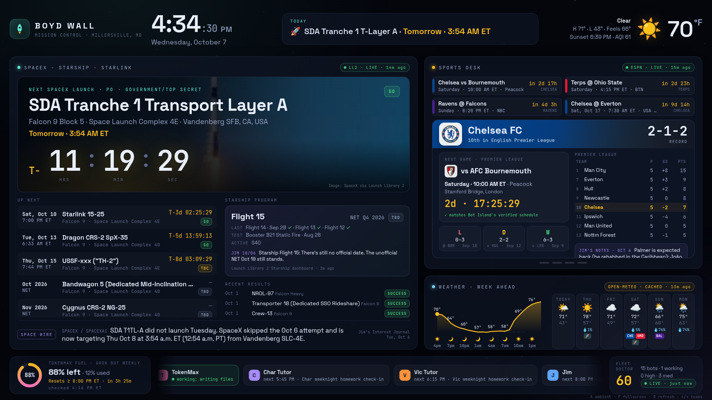
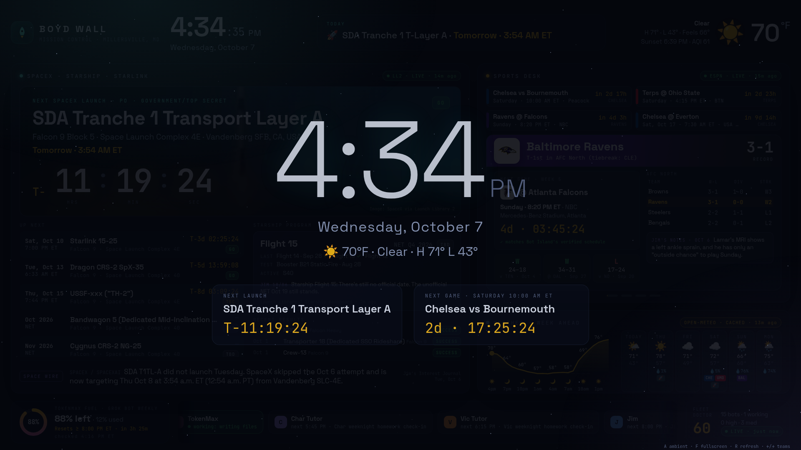
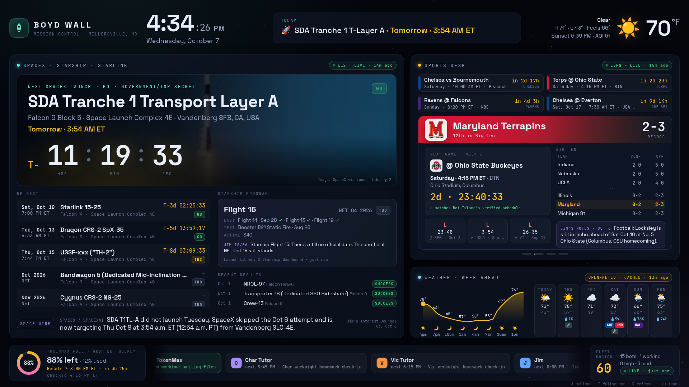
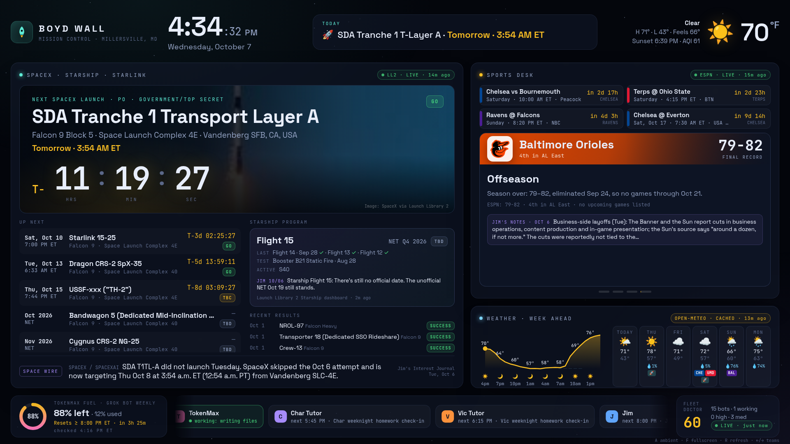
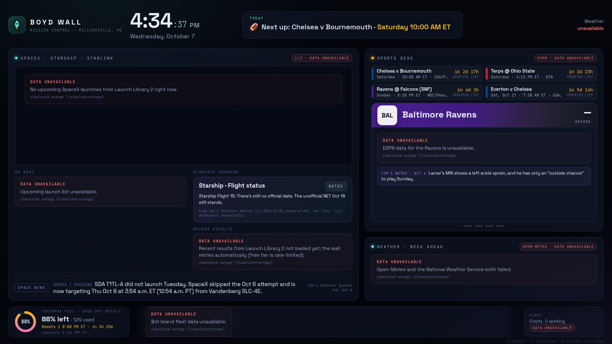
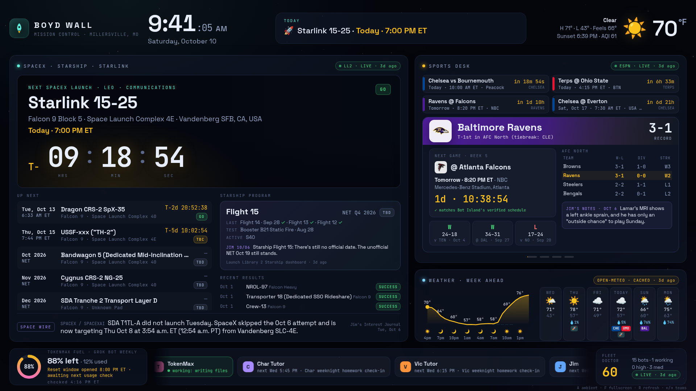
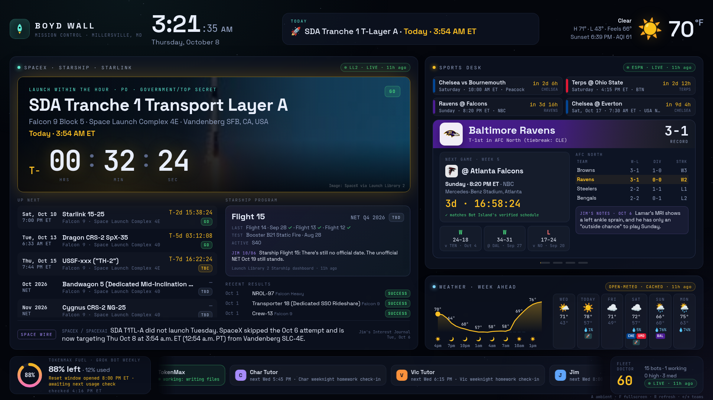
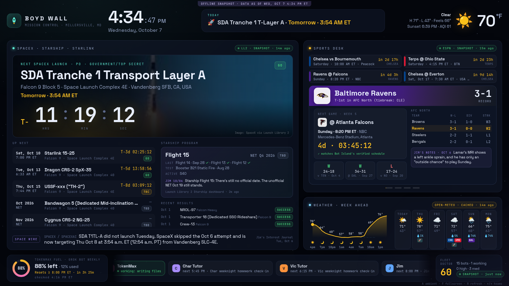

# 🛰️ Boyd Wall: mission control for a TV or second monitor

A 1920×1080 dark "mission control" dashboard for Boyd: **SpaceX/Starship/Starlink** launches with live
T-minus countdowns, a **Sports Desk** for the Ravens, Terps, Chelsea and Orioles, **Millersville weather with
the week ahead**, and a **fleet strip** showing every Grok Bot plus the TokenMax fuel gauge. It runs entirely on
free, no-key public data, caches everything, and never makes numbers up. When a source is down, the panel says
**DATA UNAVAILABLE** and gives the reason.

Built by TokenMax on Oct 7, 2026 with Grok Bot weekly usage that would otherwise have reset unused (ideas #7 and #8 in
`../SHORTLIST.md`). Sister project to [Bot Island](../bot-island) (port 4747).


| Team cards rotate every 12 s | Ambient mode (night / screensaver) |
|---|---|
|  |  |
| **Terps** with Big Ten table | **Orioles** offseason card |
|  |  |
| **Outage drill** (`?simulate=outage`): every source down, nothing invented | **Time-travel preview** (`?now=2026-10-10T09:41-04:00`): Saturday game morning |
|  |  |
| **Launch within the hour**: the hero glows amber, then turns cyan at T-0 ("awaiting result") | **Offline snapshot** opened from `file://`, with the purple banner |
|  |  |

## Run it

```bash
cd /workspace/tokenmax/boyd-wall
./run.sh            # starts in the background (idempotent); ./run.sh restart | ./run.sh stop
```

| URL | What |
|---|---|
| http://127.0.0.1:4848/ | The wall |
| http://127.0.0.1:4848/kiosk | **Kiosk URL** for a TV: hides the cursor and reloads itself every 6 h |
| http://127.0.0.1:4848/ambient | Kiosk + ambient mode (giant clock, next launch, next game, starfield) |
| `/?ambient=auto` | Switches to ambient automatically from 11 PM to 6 AM ET |
| `/?team=chelsea` · `/?rotate=20` · `/?still=1` | Start on a team, change the rotation seconds, freeze rotations (screenshots) |
| `/?simulate=outage` | Preview the "everything is down" state |
| `/?now=2026-10-10T09:41:00-04:00` | Time-travel the clock and countdowns (preview/testing; weather and bot times stay at real now) |
| `/api/wall` · `/api/health` · `/api/refresh` | Merged JSON, health with per-source refresh status, and a forced refresh |

**Keys:** `A` ambient · `F` (or double-click) fullscreen · `R` refresh now · `←/→` flip team cards.

The stage is a fixed 1920×1080 canvas that scales to fit any screen. A 4K TV gets an exact 2× and a laptop gets a
letterbox. Every minute the whole layout drifts by up to 3 px to protect OLED and plasma screens from burn-in.

The server binds to `127.0.0.1` on the box. To put it on a real TV, either open the **offline snapshot** (below) on
that machine, or run `BOYD_WALL_HOST=0.0.0.0 ./run.sh restart` on a computer the TV can reach. The code is stdlib
Python 3.9+ with no installs.

### Offline snapshot
`dist/boyd-wall-snapshot.html` is one self-contained file (1.6 MB) with the HTML, CSS, JS, fonts, team logos, the launch
photo and all the data inlined. Copy it anywhere and double-click it: no server or network needed. Countdowns keep
ticking against the viewer's clock, and a purple banner shows when the data was captured. Rebuild it with
`python3 export_snapshot.py`.

## What's on the wall

**Header:** the ET clock with seconds, the date, and a rotating **TODAY** line. The line cycles through the next launch,
the next game, today's weather and sunset, how many bot routines are left today, the TokenMax fuel level and the top
item on Jim's space wire. On the right are the current conditions, H/L, feels-like, sunset and US AQI.

**SpaceX · Starship · Starlink** (Launch Library 2)
- **Hero:** the next SpaceX launch with its mission photo (slow Ken Burns pan), rocket, pad, orbit, mission type and status pill
  (GO / TBC / TBD), plus a giant **T-minus countdown**. The countdown only appears when LL2's time precision is minute or second
  ("hour" precision gets a ~ prefix). Launches dated only to a month or quarter show "NET Oct 2026" instead of a fake clock.
- **Up next:** the next 4 launches with countdowns. **Recent results:** the last 4 launches with Success/Failure pills.
- **Starship program:** LL2's Starship dashboard (next flight, last flights ✓/✗, events, road closures, active
  hardware). When LL2 hasn't loaded, the card shows Jim's latest Starship research line, labelled as notes and not live.
- **Space wire:** a rotating ticker of SpaceX/Starlink headlines parsed from Jim's newest `ij_*_research.md`.

**Sports Desk** (ESPN public site API)
- **Next up:** the next 4 games across all teams, with ET times, TV and countdowns. "Time TBD" games never get a fake kickoff.
- **Rotating team cards:** record, standing, next game (opponent logo, venue, TV, countdown), last 3 results as W/L/D chips,
  a mini standings table (AFC North, Big Ten top 4 plus Maryland, Premier League around Chelsea), and Jim's latest note on the team.
  - Every next game is **cross-checked against Bot Island's hand-verified schedule**: "✓ matches Bot Island's verified schedule",
    or ⚠ with the other time.
  - Ravens standing: ESPN's team blurb says "1st in AFC North", but ESPN's own division table lists Cleveland first
    (both teams are 3-1). The card shows "T-1st in AFC North (tiebreak: CLE)", taken from the table, so both facts are visible.
  - Orioles: an offseason card with the 79–82 final record (ESPN) and Bot Island's note that they were eliminated Sep 24.
  - If ESPN is down for a team, Next-up falls back to Bot Island's verified game list, labelled VERIFIED LIST.

**Weather · Week ahead** (Open-Meteo, with the National Weather Service as fallback)
- A 24-hour temperature curve with precipitation bars and icons, and 6 day cards (icon, H/L, rain chance). Each day card also
  shows **the launches and games happening that day** (🚀, BAL, UMD, CHE chips).

**Fleet strip** (Bot Island API on :4747)
- **TokenMax fuel gauge** from `/workspace/tokenmax/usage.json`: % left, % used, and a countdown to the earliest reset.
  Cursor only shows the reset date, so the gauge says "Resets ≥ 8:00 PM ET".
- A scrolling ticker of every bot. Each one shows "● working: routine" (green), its next routine time and name, or how long it's been idle.
- The **Fleet Doctor** score and medium/high finding counts from Bot Island's `/api/doctor`.

## Data sources and honesty rules

| Panel | Source (no keys) | Refresh | When it fails |
|---|---|---|---|
| Launches, results | Launch Library 2 `ll.thespacedevs.com/2.3.0` (`lsp__id=121`, SpaceX) | upcoming 30 min, previous 60 min | last good copy shown as **CACHED · age**; with no copy, **DATA UNAVAILABLE** |
| Starship | LL2 `/dashboard/starship/` | 90 min | falls back to Jim's research line, clearly labelled |
| Sports | `site.api.espn.com` team schedules plus `/apis/v2/.../standings` | 15 min (2 min around kickoff) | cached copy, then Bot Island's verified list |
| Weather | `api.open-meteo.com` forecast plus air-quality API | 10 min | **NWS** `api.weather.gov` (forecast, hourly, KBWI observations) |
| Fleet | `http://127.0.0.1:4747/api/fleet` and `/api/doctor` | 60 s | cached copy, then Bot Island's `data/fleet.json` (read-only) |
| Fuel | `/workspace/tokenmax/usage.json` | every refresh | DATA UNAVAILABLE |
| Notes | newest `/workspace/ij_YYYY-MM-DD_research.md` (bold lead-ins only) | every refresh | panel hides the notes |

- Every source carries a status chip (**LIVE · 3m ago**, **CACHED · 2h ago**, **DATA UNAVAILABLE**). Hover it to see the error.
- HTTP 429s are honored. `Retry-After` is persisted in `data/cache/_backoff.json`, so restarts don't hammer an API.
  Open-Meteo's daily free quota resets at 00:00 UTC; when it runs out, the wall switches to NWS.
- LL2's free tier allows about 15 calls an hour, and the box's network shares that budget with other users. The wall
  makes about 4 calls an hour and comes back right after a back-off window ends.
- Nothing is written outside this folder. Bot Island is only read, through its API or its saved JSON.

## Files

```
server.py              stdlib HTTP server on :4848; one background thread per source
collect.py             fetchers, disk cache, back-off, parsers (LL2, ESPN, Open-Meteo, NWS, Bot Island, Jim's notes)
config.json            port, location (Millersville 39.0598,-76.6483), teams, TTLs, source URLs
web/                   index.html · style.css (design tokens at the top) · app.js · fonts/ (Space Grotesk, JetBrains Mono; OFL)
export_snapshot.py     builds dist/boyd-wall-snapshot.html
screenshot.sh          one 1920×1080 headless-Chrome screenshot;  refresh_screenshots.sh regenerates them all
tests/run.sh           unit tests (tests/test_collect.py) and the CDP browser smoke test (tests/smoke.mjs)
data/cache, data/img   cached API responses and logos/photos (safe to delete; they refill)
```

## Tests

```bash
tests/run.sh      # 14 unit tests + 24 browser checks
```

The unit tests cover the cron "next run" math, cache freshness, stale fallback, URL-change invalidation, and
**"all sources down → no numbers"** for SpaceX and weather. They also check ESPN W/L/D parsing.

The smoke test drives headless Chrome over CDP and checks:
- the API sections and the kiosk redirect
- the clock, hero countdown ticking, 4 team cards, next-up, weather, fleet ticker and fuel gauge
- that no `undefined`/`NaN` leaks into the UI, team rotation works, and ambient toggles
- a simulated full outage (every panel shows DATA UNAVAILABLE and no °F or T− numbers appear)
- kiosk cursor hiding, and that the offline snapshot loads with inlined images and no page errors

## Design system

- **Canvas:** fixed 1920×1080, 26 px outer margin, 18 px gutters, 18 px panel radius, glassy panels at
  `rgba(18,26,44,.55)` over a near-black `#04060c` starfield.
- **Type:** Space Grotesk for display and body, JetBrains Mono for numbers, labels and countdowns (tabular figures, so digits never jitter).
- **Color:** cyan `#5eead4` for space, amber `#fbbf24` for anything counting down, green/amber/red for live/cached/unavailable,
  violet `#a78bfa` for research notes, and team colors from config.
- **Motion:** slow and low-distraction. Panels crossfade over 0.8–1 s, the hero photo pans over 40 s, the bot ticker scrolls
  at about 7 s per bot, stars twinkle at 24 fps with a rare shooting star, and live chips pulse every 2.4 s.

## Known gaps

- LL2's free tier is shared with everything else on the box's network, so right after a restart some LL2 cards can say
  "rate-limited, retrying" for a few minutes. All three LL2 feeds (upcoming, recent results, Starship dashboard) were live
  by 4:33 PM ET on Oct 7.
- Open-Meteo's free daily quota on the box's shared network ran out during the build. The wall moves to the **National
  Weather Service** once Open-Meteo is unavailable or more than an hour stale, then back to Open-Meteo after 00:00 UTC (8 PM ET).
  NWS and Open-Meteo forecasts can differ: for Saturday, one showed 91% rain and the other 5%. The chip always names the active source.
- Starship timing: LL2 lists Flight 15 as "NET Q4 2026 · TBD", while Jim's Oct 6 note says the unofficial NET is Oct 19.
  The card shows both, labelled, and runs no countdown until LL2 has a real time.
- Cursor only shows the usage reset *date*, so the fuel gauge counts down to the earliest possible moment (00:00 UTC = 8 PM ET).
- ESPN is an unofficial public endpoint and could change shape. Every team card degrades to DATA UNAVAILABLE instead of breaking.
- Fleet bot "working" status comes from Bot Island's snapshot (routine last-run times and file writes), not a live agent feed.
- The server listens on localhost on the box. A TV on Boyd's network needs the snapshot file or the server run on his own machine.


---
## Repo notes
- **Built:** Oct 7, 2026, by TokenMax (Boyd's Grok Bot) on the Grok Bot box.
- **Run:** `./run.sh` (then open the localhost URL it prints).
- Imported from `/workspace/tokenmax/boyd-wall` on Oct 23, 2026. node_modules, virtualenvs, logs and files over 20 MB were left out.
